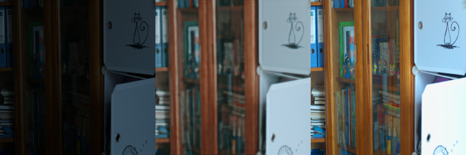

# GLARE-Lite: Low-Light Image Enhancement

A lightweight U-Net for low-light image enhancement, trained on the [LOL dataset](https://daooshee.github.io/BMVC2018website/) (paired low-light / normal-light images). It was built as a machine learning course project at USC and is a small, laptop-trainable take on GLARE-style enhancement (it runs on Apple Silicon `mps` or CPU).

The full write-up (in Persian) is in [`docs/report.pdf`](docs/report.pdf).



## Model

- 3-level U-Net (`GLARELiteUNet`, base width 32) with a residual output: `y = clamp(x + 0.5 * tanh(f(x)), 0, 1)`, so the net learns a correction to the input rather than the image itself.
- Loss (final configuration):
  `L = L1 + 0.05 * L_exposure + 0.30 * L_color(YUV chroma) + 0.10 * L_saturation`

## Experiments

Each run adds one idea on top of the previous one. Final checkpoints and validation examples (`cmp_*.png`: input / prediction / ground truth) are in `runs/`.

| Run | Epochs | Train size | Loss |
|---|---|---|---|
| `glare_lite_e20` | 20 | 256 | L1 + exposure |
| `glare_lite_e20_s320` | 20 | 320 | L1 + exposure |
| `glare_lite_e20_s320_colorLoss` | 20 | 320 | + YUV color loss |
| `glare_lite_e30_s320_colorLoss_satLoss` | 30 | 320 | + saturation loss |

Only the last-epoch checkpoint of each run is kept in the repo.

## Data

`data/train` (485 pairs) and `data/val` (15 pairs) each contain `low/` and `high/` folders with matching filenames. They are the LOL (LOLv1) train and test splits. The dataset belongs to its original authors; please cite:

> C. Wei, W. Wang, W. Yang, J. Liu. *Deep Retinex Decomposition for Low-Light Enhancement.* BMVC 2018.

and follow the dataset's own terms (research use).

## Usage

```bash
pip install -r requirements.txt

# train (final configuration)
python glare_lite.py --epochs 30 --size 320 --out runs/my_run

# train, then enhance one image at the end of training
python glare_lite.py --epochs 30 --size 320 --out runs/my_run \
    --infer_in path/to/dark.png --infer_out runs/my_run/enhanced.png
```

To use a provided checkpoint without retraining:

```python
import torch
from glare_lite import GLARELiteUNet, pick_device

device = pick_device()
model = GLARELiteUNet(base=32).to(device)
ckpt = torch.load("runs/glare_lite_e30_s320_colorLoss_satLoss/ckpt_epoch_30.pt", map_location=device)
model.load_state_dict(ckpt["model"])
model.eval()
```

## Repository layout

```
glare_lite.py   model, losses, training loop, single-image inference
data/           LOL train/val pairs
runs/           final checkpoints + validation examples per experiment
docs/report.pdf project report
```

## License

Code is released under the MIT License (see `LICENSE`). The dataset is covered by its original terms.
